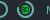

# Batteryarc widget

[](https://github.com/streetturtle/awesome-wm-widgets/labels/batteryarc)

This widget is more informative version of [battery widget](https://github.com/streetturtle/awesome-wm-widgets/tree/master/battery-widget).

Depending of the battery status it could look following ways:

 -  - less than 15 percent
 -  - less than 15 percent, charging
 -  - between 15 and 40 percent
 -  - between 15 and 40 percent, charging
 -  - more than 40 percent
 -  - more than 40 percent, charging

A notification shows up when the battery state or the upower icon changes. While the battery is discharging at 15% or less it is repeated every `warning_interval` seconds. There is only one notification at a time, no matter how many widgets there are.

## Customization

It is possible to customize widget by providing a table with all or some of the following config parameters:

| Name | Default | Description |
|---|---|---|
| `font` | Play 6 | Font |
| `arc_thickness` | 2 | Thickness of the arc |
| `show_current_level`| false | Show current charge level |
| `size`| 18 | Size of the widget |
| `main_color` | `beautiful.fg_color` | Color of the text with the current charge level and the arc |
| `bg_color` | `#ffffff11` | Color of the charge level background |
| `low_level_color` | `#e53935` | Arc color when battery charge is 15% or less |
| `medium_level_color` | `#c0ca33` |  Arc color when battery charge is between 15% and 40% |
| `charging_color` | `#43a047` |  Color of the circle inside the arc when charging  |
| `show_notification_mode` | `on_hover` | How to trigger a notification with the battery status: `on_hover`, `on_click` or `off`  |

All the widgets share one upower poller and one notification, so the following parameters are only read from the first created widget:

| Name | Default | Description |
|---|---|---|
| `timeout` | 10 | How often in seconds the widget refreshes |
| `upower_device` | `/org/freedesktop/UPower/devices/DisplayDevice` | Device passed to `upower -i` |
| `enable_battery_warning` | `true` | Show notifications without being asked to: on state changes and on low battery |
| `warning_interval` | 300 | How often in seconds to repeat the low battery notification |
| `warning_timeout` | 30 | For how long in seconds these notifications stay on the screen |
| `warning_msg_position` | `bottom_right` | Position of the notification |
| `msg_icon_dir` | `/usr/share/icons/Arc/status/symbolic` | Directory with the upower icons, as `.svg` files |
| `notify_icon_size` | 200 | Maximum size of the notification icon |
| `notify_width` | 350 | Width of the notification |
| `notify_bg_color` | `#000000` | Background color of the notification |

## Requirements

This widget requires the `upower` command to be available to retrieve battery and
power information.

## Installation

Clone repo, include widget and use it in **rc.lua**:

```lua
local batteryarc_widget = require("awesome-wm-widgets.batteryarcthinkpad-widget.batteryarc")
...
s.mytasklist, -- Middle widget
	{ -- Right widgets
    	layout = wibox.layout.fixed.horizontal,
		...
        --[[default]]
		batteryarc_widget(),		
        --[[or customized]]
        batteryarc_widget({
            show_current_level = true,
            arc_thickness = 1,
        }),
	}
	...
```

## Troubleshooting

In case of any doubts or questions please raise an [issue](https://github.com/streetturtle/awesome-wm-widgets/issues/new).
